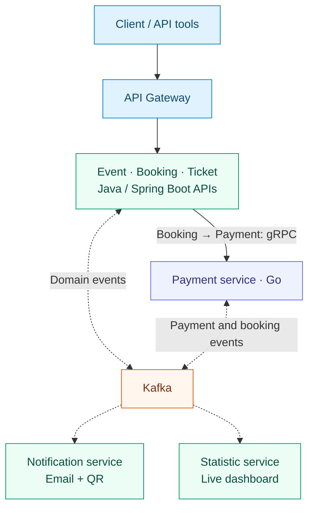

<div align="center">
  <h1>🎟️ TicketHub Platform</h1>
  <p><strong>A distributed ticket-booking backend built with Java and Go.</strong></p>
  <p>Seat reservations · Mock payments · Event-driven fulfillment · Recoverable background work</p>

  
  
  
  
  
  

  <p>
    <a href="docs/architecture.md">Architecture</a> ·
    <a href="docs/booking-flow.md">Booking lifecycle</a> ·
    <a href="docs/local-development.md">Local setup</a> ·
    <a href="docs/testing.md">Tests</a> ·
    <a href="docs/project-status.md">Status & next steps</a>
  </p>
</div>

---

## What the project explores

TicketHub is a learning and portfolio project about coordinating a purchase across independent services. Its main problems are competing requests for the same seat, repeated messages, payment outcomes arriving after cancellation, and background work recovering after failure.

The current implementation includes event publishing and search, a **10-minute booking hold**, a separate payment-start operation, mock payment success/failure, ticket issuance and scanning, email with a QR code for each ticket, and a live statistics dashboard.

**Current stage:** stabilization and automated testing. Payments are simulated; the Docker Compose stack is a local development environment. Known cancellation, delivery, and setup limitations are recorded in [project status](docs/project-status.md).

## Architecture at a glance

Six domain services sit behind or alongside a Spring Cloud Gateway. Booking uses synchronous HTTP and gRPC for immediate decisions; Kafka carries domain events to downstream services.



Solid arrows show synchronous calls; dashed arrows show asynchronous delivery. This overview omits storage, authentication, and some internal calls for readability. See the [detailed architecture](docs/architecture.md) for those boundaries.

| Component | Responsibility | Storage / integration |
|---|---|---|
| `api-gateway` | Routing, role-based JWT checks, rate limiting and fallback | Keycloak, Redis |
| `event-service` | Events, seat definitions, publishing and search | PostgreSQL, Elasticsearch, Kafka |
| `booking-service` | Holds, reservations, guest access, payment coordination and expiry | PostgreSQL, Redis, HTTP, gRPC, Kafka |
| `payment-service` | Mock payment state, idempotent creation and compensation | Go, PostgreSQL, gRPC, HTTP, Kafka |
| `ticket-service` | Ticket issuance, scanning and cancellation | PostgreSQL, Kafka, internal HTTP |
| `notification-service` | Persistent email jobs, retries and QR generation | MongoDB, Kafka, SMTP / Mailpit |
| `statistic-service` | Persistent counters and live dashboard snapshots | PostgreSQL, Kafka, WebSocket |

## A purchase, step by step

1. Select seats from a published event.
2. Create a booking with a client-generated `X-Booking-Token` and `Idempotency-Key`. The booking enters `HOLD`; payment is **not** started by this request.
3. Start payment with `POST /api/v1/bookings/{bookingId}/payment` using the same booking token.
4. Complete the payment through the local mock API.
5. Payment events drive booking confirmation. Booking events drive ticket issuance, and ticket events create email jobs.
6. Read tickets through the guest-protected API and inspect the email in Mailpit. Downstream results become available asynchronously.

The [booking lifecycle](docs/booking-flow.md) describes the requests, transitions, and late-payment/cancellation outcomes. A booking can remain `CANCELLED` while its payment is `REFUNDED`: these are states of different entities.

## Reliability mechanisms and their boundaries

| Mechanism | What it does | Boundary |
|---|---|---|
| Redis Lua seat holds | Coordinates temporary multi-seat holds | PostgreSQL reservations also enforce seat uniqueness; Redis is not the only protection |
| Booking row locks | Serializes competing changes to one booking | Cross-service outcomes still require events and compensation |
| Idempotency and processed-event records | Makes retries recognizable in the implemented paths | Keys and payload semantics matter; broader race tests are still planned |
| Transactional outbox | Commits a business change and its outgoing event in the same local database transaction | Kafka publication happens later and can repeat; search-change publishing currently bypasses outbox |
| Persistent Redis tasks | Records `MARK_SOLD` / `RELEASE` work for retry | Concurrent cleanup/enqueue behavior still needs a targeted test |
| MongoDB task leases and tokens | Lets another email worker reclaim expired work and rejects stale completion updates | SMTP sending and marking `SENT` are not atomic; a crash can still cause duplicate email |

The delivery model is **at-least-once with idempotent handling where implemented**, not a blanket exactly-once guarantee. The project does not claim production availability or benchmarked throughput.

## Run locally

Start with the [local development guide](docs/local-development.md). It covers environment variables, manual Keycloak realm setup, host ports, and troubleshooting. The current `.env-example` is empty and no realm import is bundled, so a fresh checkout needs those setup steps first.

Once configured, run from the repository root:

```sh
docker compose config --quiet
docker compose up -d --build
docker compose ps
```

To rebuild only an edited service:

```sh
docker compose build booking-api
docker compose up -d --no-deps booking-api
```

| Local entry point | Address |
|---|---|
| Public API gateway | [localhost:8080](http://localhost:8080) |
| Mock payments | [localhost:8085/api/v1/mock/payments](http://localhost:8085/api/v1/mock/payments) — API prefix |
| Keycloak | [localhost:8180](http://localhost:8180) |
| Email inbox — Mailpit | [localhost:8025](http://localhost:8025) |
| Live statistics | [localhost:8087/dashboard.html](http://localhost:8087/dashboard.html) |
| Grafana | [localhost:3000](http://localhost:3000) |
| Prometheus | [localhost:9091](http://localhost:9091) |
| Jaeger | [localhost:16686](http://localhost:16686) |

Observability components are included in Compose. Complete trace propagation, dashboards, and metrics coverage across every service are still being verified; see [architecture](docs/architecture.md).

## Tests

The current source contains **13 notification tests**: 4 Mockito tests for the sender and 9 MongoDB integration tests for task ownership and state transitions. Other domains still need automated scenario coverage. See the [test guide](docs/testing.md) for requirements and the coverage inventory.

With a compatible JDK and Docker running, on Windows:

```powershell
.\gradlew.bat :notification-service:test
```

On a POSIX shell:

```sh
./gradlew :notification-service:test
```

The MongoDB tests use Testcontainers; the whole application stack does not need to be running. A successful container build is not a test run.

## Documentation map

| Document | Read it for |
|---|---|
| [Architecture](docs/architecture.md) | Service boundaries, data ownership, event routes and guarantees |
| [Booking lifecycle](docs/booking-flow.md) | Purchase, fulfillment, cancellation and payment state diagrams |
| [Local development](docs/local-development.md) | Setup, credentials configuration, URLs, rebuilds and diagnostics |
| [Testing](docs/testing.md) | Existing tests, execution commands and the next testing steps |
| [Project status](docs/project-status.md) | Known limitations and a bounded plan for the first version |
| [Mentoring backlog](docs/mentoring-backlog.md) | Detailed historical review and acceptance notes, in Russian |

<details>
<summary><strong>Repository layout</strong></summary>

```text
tickethub/
├── api-gateway/             # Routing and gateway security
├── booking-service/         # Booking, reservations and Redis tasks
├── event-service/           # Event catalogue, seats and search
├── payment-service/         # Go payment service and SQL migrations
├── ticket-service/          # Ticket lifecycle
├── notification-service/    # Email jobs, QR generation and current tests
├── statistic-service/       # Persistent metrics and live dashboard
├── contracts/               # Protobuf contract and event examples
├── db-init/                 # Logical PostgreSQL database initialization
├── docs/                    # Architecture, flows, setup and roadmap
├── prometheus/              # Scrape configuration
├── promtail/                # Log collection configuration
└── docker-compose.yml       # Local application and infrastructure stack
```

</details>
