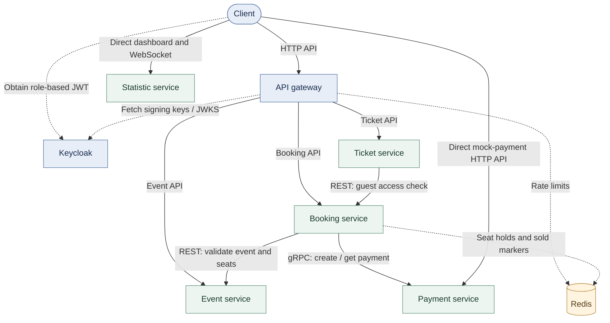
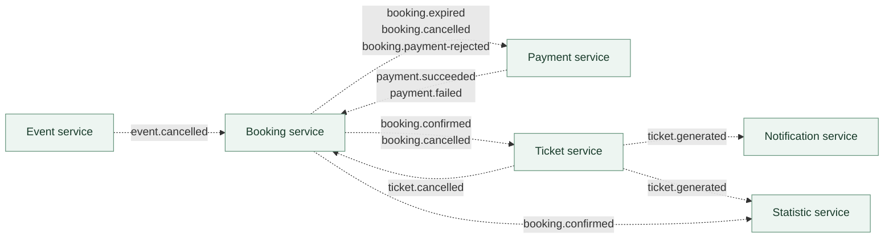

# System architecture

[← Project overview](../README.md) · [Booking lifecycle](booking-flow.md) · [Local setup](local-development.md)

TicketHub has six domain services and an API gateway. REST and gRPC handle requests that need an immediate answer; Kafka carries domain events published by outbox relays after local transactions commit. Search changes currently use a separate direct-publish path. PostgreSQL owns booking and payment state, Redis coordinates short-lived seat holds, and downstream services build tickets, notifications and statistics.

This page describes the checked-in implementation and its Docker Compose topology. For the request-by-request lifecycle, see [Booking flow](booking-flow.md); for setup, see the [README](../README.md).

## Service boundaries

| Component | Responsibility | Owned storage |
| --- | --- | --- |
| **API gateway** | Routes event, booking and ticket HTTP APIs; validates JWTs and roles; applies IP-based rate limits and a circuit breaker | Redis rate-limit keys |
| **Event service** | Event catalogue, seat definitions and prices, publication and event cancellation; search | PostgreSQL `event_db`; Elasticsearch event index |
| **Booking service** | Guest access, booking idempotency, holds, seat reservations, payment initiation and cancellation coordination | PostgreSQL `booking_db`; Redis seat keys |
| **Payment service** | Idempotent payment creation, mock payment outcomes, expiry, cancellation and simulated refunds | PostgreSQL `payment_db` |
| **Ticket service** | Ticket records, guest queries, individual cancellation and one-time scanning | PostgreSQL `ticket_db` |
| **Notification service** | Durable email tasks, retrying delivery and QR images for each ticket | MongoDB `notification_db` |
| **Statistic service** | Cumulative confirmed-booking and generated-ticket counters; dashboard updates | PostgreSQL `statistic_db` |
| **Keycloak** | JWT issuance and realm roles | PostgreSQL `keycloak_db` |

The gateway and five domain services use Java/Spring Boot; Payment uses Go, Gin and gRPC. Notification produces QR images for email; Ticket stores ticket records rather than generating PDFs.

### Data ownership in the local deployment

Compose runs **one PostgreSQL instance with separate logical databases**, initialized by [create-databases.sql](../db-init/create-databases.sql). Services connect to their own databases, and their source does not join across service databases. The Compose configuration reuses database credentials, so this is an application ownership boundary, not isolation enforced by separate database users or servers.

MongoDB, Elasticsearch and Redis are separate containers. Elasticsearch is a derived search index. Redis supports both seat coordination and gateway rate limiting; PostgreSQL reservations remain the durable constraint on seat allocation. Compose persists PostgreSQL, MongoDB, Kafka and Elasticsearch with named volumes; it does not configure a Redis data volume.

## Request topology

Solid arrows are HTTP or gRPC calls. Dotted arrows show authentication and shared Redis dependencies. Notification is driven by Kafka and appears in the event diagram below.

The gateway exposes only the Event, Booking and Ticket route families. The local mock-payment API is published separately on loopback port `8085`; the statistics dashboard and `/ws/metrics` use port `8087`. They are not gateway routes. Internal seat validation and booking access checks use service-to-service HTTP on the Compose network.

### Authentication and guest access

The gateway validates JWTs using Keycloak signing keys and the configured issuer. Event administration requires `ADMIN` or `ORGANIZER`; ticket scanning requires `ADMIN` or `CONTROLLER`. It denies `/api/v1/internal/**` and unmatched routes. Public catalogue reads and guest booking/ticket operations are explicitly allowed through the gateway.

Guest ownership is checked in the domain services with **`X-Booking-Token`**, a client-supplied string of 64 lowercase hexadecimal characters. Booking stores its SHA-256 hash and compares hashes for later access. Ticket calls Booking's internal access-check endpoint before guest queries or cancellation. A booking ID alone is insufficient. Creating a booking also requires `Idempotency-Key`, scoped to the guest token hash and checked against a request hash.

These boundaries follow [gateway security rules](../api-gateway/src/main/java/dev/project/gateway/security/config/SecurityConfig.java), [guest token validation](../booking-service/src/main/java/dev/project/booking/api/services/GuestBookingTokenService.java) and [ticket access checks](../ticket-service/src/main/java/dev/project/ticket/api/service/GuestTicketAccessService.java). Internal HTTP and gRPC calls depend on the local network boundary; they do not implement service-to-service authentication.

## Event topology

Every dotted arrow below travels through Kafka. Labels name the events that trigger business work at the destination; they are not direct service calls. The producers use their own PostgreSQL outboxes for these domain events.

| Kafka topic | Producer | Events and consumers |
| --- | --- | --- |
| `tickethub.event.events.v1` | Event outbox | `event.cancelled` → Booking |
| `tickethub.payment.events.v1` | Payment outbox | `payment.succeeded`, `payment.failed` → Booking. `payment.refunded` is also published; Booking validates it and returns without changing state. |
| `tickethub.booking.events.v1` | Booking outbox | `booking.confirmed` → Ticket and Statistic; `booking.cancelled` → Ticket and Payment; `booking.expired`, `booking.payment-rejected` → Payment |
| `tickethub.ticket.events.v1` | Ticket outbox | `ticket.generated` → Notification and Statistic; `ticket.cancelled` → Booking |
| `tickethub.events.changes.v1` | Event service, direct publish | `EventSyncMessage` → Event's search listener → Elasticsearch |

Domain messages use versioned envelopes with an event ID, event type, producer, aggregate information, correlation ID and payload. The event ID identifies a message for deduplication; `payload.eventId` can instead identify the catalogue event. Search messages use a different DTO. See [event examples](../contracts/events/) and the [payment gRPC contract](../contracts/payment/v1/payment.proto); the example files cover only part of the event catalogue.

### Cancellation and compensation

A published event's cancellation first creates an Event outbox message. Booking records the cancelled event, and a scheduled job cancels affected `HOLD`, `CONFIRMED` or `PARTIALLY_CANCELLED` bookings in batches. Each affected booking emits `booking.cancelled`. Ticket cancels active tickets, while Payment cancels pending payments or records a simulated refund for successful payments.

Payment and Ticket keep cancellation records so that a cancellation delivered before payment creation or ticket generation can still block the later action. Booking also records cancelled events to reject new bookings once the cancellation has been consumed. These are asynchronous safeguards; propagation is not instantaneous.

Individual ticket cancellation is a separate path: `ticket.cancelled` releases that seat in Booking and updates the booking's status. It does **not** currently emit `booking.cancelled` or request a partial refund, even when the last ticket is cancelled. Notification consumes only `ticket.generated`, so cancellation does not generate an email in the current implementation.

## Consistency and recovery

### Local transactions and at-least-once delivery

Event cancellation, Booking, Payment and Ticket write business changes and their outgoing domain events in the **same local PostgreSQL transaction**. Background relays publish pending outbox rows, wait for Kafka acknowledgement and then mark the rows published. Failed attempts remain eligible for retry with backoff.

The database commit and Kafka publication are separate operations. A crash after Kafka accepts a message but before the row is marked published can cause the relay to publish it again. This is an **at-least-once publication design**, not an end-to-end exactly-once guarantee or a distributed transaction.

Booking, Payment, Ticket and Statistic register `(consumer_name, event_id)` in `processed_events` within the same transaction as their local changes. Redelivery of the same event ID therefore skips already committed work. Database constraints, payment idempotency and state checks provide additional safeguards. Notification deduplicates task creation by using the message event ID as MongoDB's document `_id`.

Booking, Ticket and Statistic configure Kafka error handlers with bounded retries and `<source-topic>.dlt` destinations; Payment also retries and uses a booking-event DLT. Validation errors in those Java handlers can go directly to the DLT. Notification and search do not have equivalent custom DLT configuration. A message successfully sent to a DLT is available for investigation; the repository does not provide automatic replay. Eventual completion depends on running relays and consumers, available storage and brokers, and recovery of failed messages.

### Seat coordination

1. Event validates catalogue state, seat membership and prices through an internal REST endpoint. Booking owns reservation availability.
2. Booking's Redis Lua script acquires all requested seat keys atomically or none of them. Holds currently expire after **10 minutes**, using the booking's absolute expiry timestamp.
3. Booking commits the booking, seat-price snapshot, reservations and idempotency result to PostgreSQL. A unique `(event_id, seat_id)` reservation constraint prevents two persisted reservations for the same seat, including when Redis state is missing.
4. Confirmation, expiry and cancellation update SQL state and enqueue durable Redis tasks in the same transaction. A worker marks seats sold or releases holds/sold markers. Release checks the booking owner before deleting a key.

SQL and Redis do not share a transaction. Redis can temporarily lag behind committed booking state, and a remaining SQL reservation can still block a seat after its Redis hold expires until the expiry job removes it. The durable task queue repairs pending Redis updates; it is not a full rebuild of all Redis keys after data loss.

The implementation lives in [SeatHoldService](../booking-service/src/main/java/dev/project/booking/redis/service/SeatHoldService.java), [BookingPersistenceService](../booking-service/src/main/java/dev/project/booking/api/services/BookingPersistenceService.java), [RedisCleanupService](../booking-service/src/main/java/dev/project/booking/redis/service/RedisCleanupService.java) and the [reservation schema](../booking-service/src/main/resources/db/changelog/changeset/001-create-booking-booking_seats-table.sql).

### Notification delivery

The Kafka listener inserts a pending MongoDB task. A scheduled sender atomically claims one eligible task with a lease and lock token, generates a QR image containing each ticket ID, and sends an HTML email through SMTP. Compose uses Mailpit as the mail sink. Failed sends are rescheduled; expired leases allow abandoned tasks to be claimed again.

SMTP delivery and marking a task `SENT` are separate operations. A crash between them can produce a duplicate email. Task deduplication and lease ownership do not make external email delivery exactly once. See [NotificationTaskRepository](../notification-service/src/main/java/dev/project/repository/mongodb/NotificationTaskRepository.java) and [NotificationSender](../notification-service/src/main/java/dev/project/service/NotificationSender.java).

### Statistics and search projections

**Statistics** transactionally increments SQL counters alongside its processed-event record. While WebSocket clients are connected, a scheduled broadcaster reads the SQL snapshot every second and sends `totalBookings`, `totalTickets` and a timestamp. These are cumulative confirmed bookings and generated tickets; cancellations do not decrement them. The dashboard is an eventually consistent projection, with no Redis-backed counter store. See [StatisticsService](../statistic-service/src/main/java/dev/project/statistic/api/service/StatisticsService.java) and [MetricsWebSocketHandler](../statistic-service/src/main/java/dev/project/statistic/websockets/handler/MetricsWebSocketHandler.java).

**Search has a different reliability boundary.** Event creation, updates, publication and cancellation call `KafkaTemplate.send` directly from the service transaction. The code does not wait for that send or save the search message to an outbox. The database change and search message can therefore diverge after a publish failure or transaction rollback. The search listener writes Elasticsearch documents, and search results are reloaded from PostgreSQL with a `PUBLISHED` filter. That filter protects catalogue visibility but cannot recover a missing or stale search match. No automatic reindex/reconciliation job is present. See [EventServiceImpl](../event-service/src/main/java/dev/project/event/api/service/impl/EventServiceImpl.java) and [EventSearchSyncListener](../event-service/src/main/java/dev/project/event/kafka/listener/EventSearchSyncListener.java).

## Deployment and observability scope

[Docker Compose](../docker-compose.yml) describes a local development stack: one instance per service, one PostgreSQL server, one Kafka broker, one-partition topics with replication factor one, Keycloak in development mode, and a mock payment API. The outbox and idempotency mechanisms do not make that topology highly available, and simulated refunds do not integrate with an external payment provider.

Prometheus is configured to scrape Booking, Ticket, Event, the gateway's management port and Payment. Grafana, Jaeger, Loki and Promtail are included for metrics, traces and container logs. Java services and the Go HTTP/gRPC server contain tracing instrumentation, but the repository does not establish complete tracing coverage of every asynchronous boundary. Notification and Statistic are not included in the checked-in Prometheus scrape targets.

Use [prometheus.yml](../prometheus/prometheus.yml), [Promtail configuration](../promtail/config.yml), service application configuration and Compose as the source of truth for enabled telemetry. Presence of the observability containers alone does not imply provisioned dashboards, alerts or verified end-to-end coverage.
