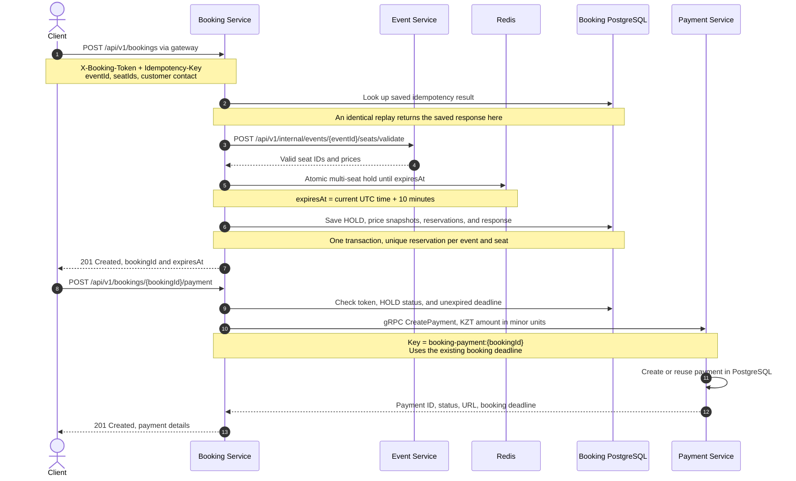
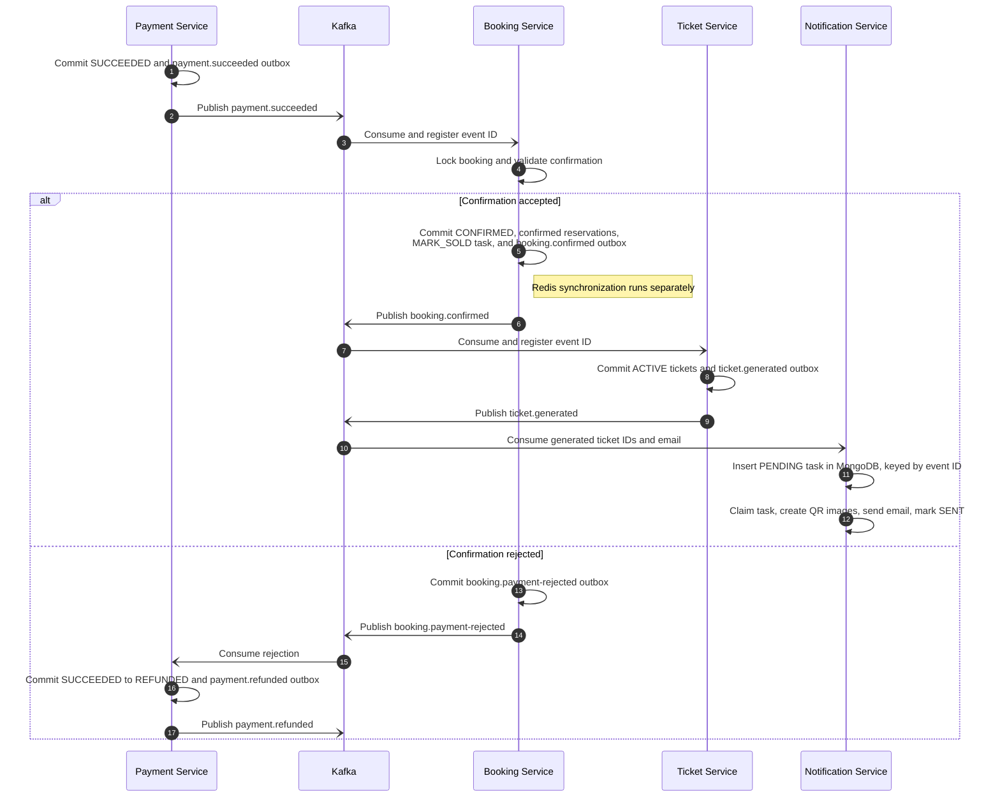
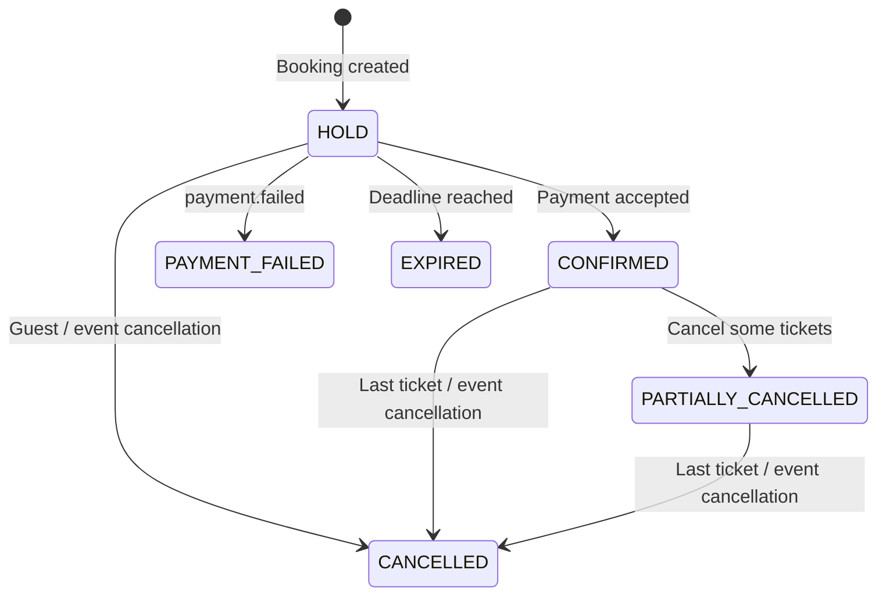

# Booking, Payment, and Ticket Lifecycle

[← Project overview](../README.md) · [Architecture](architecture.md) · [Known limitations](project-status.md)

TicketHub creates a **10-minute `HOLD` booking first**, then starts payment through a separate request. Payment confirmation, ticket creation, email delivery, and cancellation propagation run asynchronously. This document describes the current implementation; the diagrams show the main transitions rather than every error response.

## 1. Create a hold, then start payment

Guest booking requests use a client-supplied `X-Booking-Token`: exactly 64 lowercase hexadecimal characters. Booking Service stores its SHA-256 hash and checks the token on booking reads, payment operations, and cancellation. Ticket Service delegates guest access checks to Booking Service. These guest routes do not require a JWT at the gateway; administrative and ticket-scanning routes have separate role checks.

Booking creation also requires a nonblank `Idempotency-Key` of at most 255 characters. The key is scoped to the token hash. Repeating the same request returns the stored creation response; reusing the key with different request data returns a conflict. Seat IDs are sorted for request hashing, so their order does not change request identity. A replay returns the original response snapshot: use `GET /api/v1/bookings/{bookingId}` to read the current status.

Event Service checks that the event is `PUBLISHED`, has not started, and owns every selected seat. It supplies prices; it does not decide whether another booking holds those seats. Redis checks all requested keys in one Lua script and sets them with the same absolute expiry (`PXAT`). PostgreSQL additionally enforces `UNIQUE (event_id, seat_id)` in `seat_reservations`. A Redis conflict or an existing database reservation prevents creation. Failed persistence attempts release the attempted Redis hold; a process crash can leave that hold until its TTL expires.

The request accepts one to ten distinct seats and requires an email address or phone number. Starting payment sums the stored prices, converts them to minor units, and fixes the currency to `KZT`. Payment Service checks the supplied key and booking ID for existing payments, validates matching booking/amount/currency data, and has unique constraints on both booking ID and idempotency key. Starting payment does not extend the hold.

Use `GET /api/v1/bookings/{paymentId}/payment` with the booking token to read payment status through the gateway. Despite the `/bookings` prefix, this endpoint takes a **payment ID**; the payment-start endpoint takes a booking ID.

The returned payment URL points to the mock payment API. When `MOCK_PAYMENTS_ENABLED` is enabled, Payment Service exposes `GET /api/v1/mock/payments/{paymentId}`, `POST /api/v1/mock/payments/{paymentId}/succeed`, and `POST /api/v1/mock/payments/{paymentId}/fail` on its own HTTP listener. These are JSON endpoints, and the gateway has no payment-service route. The failure request carries a `reason` field.

Sources: [booking controller](../booking-service/src/main/java/dev/project/booking/api/controllers/BookingController.java), [booking orchestration](../booking-service/src/main/java/dev/project/booking/api/services/impl/BookingServiceImpl.java), [token validation](../booking-service/src/main/java/dev/project/booking/api/services/GuestBookingTokenService.java), [idempotency storage](../booking-service/src/main/java/dev/project/booking/api/services/BookingIdempotencyService.java), [seat validation](../event-service/src/main/java/dev/project/event/api/service/impl/SeatServiceImpl.java), [Redis scripts](../booking-service/src/main/java/dev/project/booking/redis/service/SeatHoldService.java), [payment creation](../payment-service/internal/service/create_payment.go), [mock routes](../payment-service/cmd/server/main.go), [gateway security](../api-gateway/src/main/java/dev/project/gateway/security/config/SecurityConfig.java).

## 2. Confirm payment and fulfill the booking

Payment Service changes a pending payment to `SUCCEEDED` and writes `payment.succeeded` to its outbox in the same PostgreSQL transaction. A relay publishes it to Kafka. The success endpoint rejects a pending payment when its booking deadline has passed; calling it again for an already successful payment returns the existing result.

Booking Service accepts a success event only when the booking is still `HOLD`, `paidAt` is **strictly before** `expiresAt`, the nonempty seat set matches the held reservations, and amount/currency match the stored booking prices. It records `confirmedPaymentId`; another success for that payment becomes a no-op, while a different payment is rejected.

A delayed success can still confirm after wall-clock expiry if its `paidAt` was before the deadline and the expiry worker has not changed the booking. If expiry or cancellation already won the booking row lock, confirmation is rejected even when payment occurred before the deadline. Rejection emits `booking.payment-rejected`; Payment Service changes a matching `SUCCEEDED` payment to `REFUNDED` and emits `payment.refunded`. Booking Service deliberately ignores that refund event. The rejection itself does not change the booking status or release reservations.

Ticket Service creates one `ACTIVE` database ticket per seat. It serializes confirmation and cancellation for a booking and records cancellation markers, so a confirmation processed after a known cancellation does not create tickets. Clients retrieve tickets with `GET /api/v1/tickets/{bookingId}` and the booking token. The scan endpoint, `POST /api/v1/tickets/{ticketId}/scan`, changes `ACTIVE` to `SCANNED`; cancelled or previously scanned tickets return an unsuccessful scan result.

Notification Service handles `ticket.generated` by inserting one MongoDB task per event ID. Its sender polls every second, claims one task with a one-minute lease, generates PNG QR codes containing the ticket IDs, and sends one HTML email containing all ticket QR images. Failures become eligible for retry after 30 seconds; an expired processing lease can be reclaimed. Ticket Service stores ticket records; the current fulfillment path does not generate PDFs.

Sources: [payment success](../payment-service/internal/service/succeed_payment.go), [transactional payment/outbox write](../payment-service/internal/repository/succeed_payment.go), [confirmation rules](../booking-service/src/main/java/dev/project/booking/api/services/BookingPersistenceService.java), [payment event handler](../booking-service/src/main/java/dev/project/booking/integration/kafka/handler/PaymentEventHandler.java), [refund processing](../payment-service/internal/repository/booking_payment_rejected_repository.go), [ticket event handler](../ticket-service/src/main/java/dev/project/ticket/integration/kafka/handler/BookingEventHandler.java), [notification sender](../notification-service/src/main/java/dev/project/service/NotificationSender.java), [notification leases](../notification-service/src/main/java/dev/project/repository/mongodb/NotificationTaskRepository.java).

## 3. Expiry, failure, and cancellation

Payment creation leaves the booking in `HOLD`. A rejected confirmation leaves its current status unchanged. Cancelling another ticket while some reservations remain keeps a `PARTIALLY_CANCELLED` booking in that state; that self-transition is omitted from the diagram for readability. The table below distinguishes the effects of each cancellation path.

| Trigger | Booking and seat effects | Payment and ticket effects |
| --- | --- | --- |
| Hold expiry | A worker runs every 30 seconds, selecting up to 100 overdue `HOLD` bookings. It locks and rechecks each booking, sets `EXPIRED`, deletes reservations, and writes `booking.expired` plus a Redis release task. | Payment Service changes an existing `PENDING` payment to `EXPIRED`. A successful payment is handled by the success/rejection path above. |
| `payment.failed` | A `HOLD` booking becomes `PAYMENT_FAILED`; reservations are deleted and Redis release is queued. | Payment Service has already stored `FAILED` and the event atomically. No tickets are issued. |
| Guest booking cancellation | `POST /api/v1/bookings/{bookingId}/cancel` accepts `HOLD`, sets `CANCELLED`, deletes reservations, and writes `booking.cancelled` plus a Redis release task. Repeating cancellation of an already `CANCELLED` booking is a no-op. `CONFIRMED`, `PARTIALLY_CANCELLED`, `EXPIRED`, and `PAYMENT_FAILED` are rejected. | `booking.cancelled` changes a pending payment to `CANCELLED`, or a successful one to `REFUNDED` with a `payment.refunded` outbox event. Ticket Service cancels existing `ACTIVE` tickets and records a cancellation marker. |
| Event cancellation | `PATCH /api/v1/events/admin/{eventID}/cancel` requires an administrative/organizer role at the gateway. Cancelling a published event before its start writes `event.cancelled`. Booking Service records the event marker; a worker runs every five seconds and selects up to 100 `HOLD`, `CONFIRMED`, or `PARTIALLY_CANCELLED` bookings to cancel. Each cancellation removes reservations, marks booking seats cancelled, and writes `booking.cancelled` plus a Redis release task. | The same payment and ticket handlers apply. Ticket cancellation changes only `ACTIVE` tickets; `SCANNED` tickets remain scanned. Draft cancellation emits no `event.cancelled`; completed events and already-started published events cannot be cancelled. |
| Individual ticket cancellation | `POST /api/v1/tickets/{ticketId}/cancel` requires the booking token. An `ACTIVE` ticket becomes `CANCELLED` and emits `ticket.cancelled`. Booking Service deletes that confirmed reservation, marks the booking seat cancelled, sets `PARTIALLY_CANCELLED` or `CANCELLED` according to remaining reservations, and queues Redis release. | Repeating cancellation is a no-op; scanned tickets cannot be cancelled. This path emits no `booking.cancelled` or financial event, even for the final ticket, so it does **not** trigger a refund. |

Cancellation markers also protect creation against some reordered messages: Booking Service checks its cancelled-event table while creating a booking, Payment Service checks its cancelled-booking table while inserting a payment, and Ticket Service checks its cancelled-booking table before generating tickets. These markers take effect after their events have been consumed.

Redis updates after booking transitions use durable tasks committed with the booking changes. A worker runs every five seconds, applying `MARK_SOLD` only to active seats of confirmed/partially cancelled bookings and releasing eligible keys only when they belong to that booking. Redis data-access failures are scheduled for another attempt after 30 seconds. Database reservations remain the durable seat constraint while Redis catches up. Redis TTL expiry alone does not change the booking or remove its database reservations.

Sources: [expiry worker](../booking-service/src/main/java/dev/project/booking/utils/BookingExpirationJob.java), [expiry transaction](../booking-service/src/main/java/dev/project/booking/api/services/BookingExpirationService.java), [cancellation and seat transitions](../booking-service/src/main/java/dev/project/booking/api/services/BookingPersistenceService.java), [event cancellation](../event-service/src/main/java/dev/project/event/api/service/impl/EventServiceImpl.java), [event cancellation worker](../booking-service/src/main/java/dev/project/booking/utils/EventCancellationJob.java), [payment cancellation/refund transaction](../payment-service/internal/repository/booking_cancelled_repository.go), [individual ticket cancellation](../ticket-service/src/main/java/dev/project/ticket/api/service/TicketQueryService.java), [Redis task processing](../booking-service/src/main/java/dev/project/booking/redis/service/RedisCleanupService.java).

## Delivery semantics and known limitations

The default topic names are `tickethub.payment.events.v1`, `tickethub.booking.events.v1`, `tickethub.ticket.events.v1`, and `tickethub.event.events.v1`. Relays publish committed outbox records and then mark them published. A failure between those steps can cause redelivery. Consumers use processed-event records, domain checks, unique constraints, and cancellation markers to suppress repeated effects in their supported paths. This is an at-least-once design with deduplication, not an end-to-end exactly-once guarantee.

- **Payment is simulated.** `REFUNDED` is a local database transition with an outbox event. The repository has no external payment-provider settlement or refund integration.
- **State converges asynchronously.** Successful payment does not immediately imply tickets or email are ready. Cancellation, expiry, Kafka consumption, outbox publication, and Redis synchronization depend on running workers and healthy dependencies; the scheduled intervals are not completion deadlines.
- **Individual ticket refunds are missing.** Cancelling some or all tickets releases their seats but does not adjust the payment. The implementation contains no partial-refund calculation.
- **Email can be repeated or become stale.** SMTP sending and marking a MongoDB task `SENT` are separate operations. A crash or lease expiry after sending can lead to another send. Notification Service handles generated-ticket events only; cancellation does not revoke queued emails or send a cancellation notice.
- **Phone-only booking does not provide SMS fulfillment.** The booking API accepts a phone number without email, but the notification path still attempts email delivery and has no SMS sender.
- **Not every reordered failure is a no-op.** A distinct `payment.failed` event received after a booking has left `HOLD` raises a conflict in Booking Service. Deduplication and retry mechanisms should not be read as proof that every race or failure sequence is resolved.

Sources: [payment outbox relay](../payment-service/internal/outbox/relay.go), [ticket outbox relay](../ticket-service/src/main/java/dev/project/ticket/integration/kafka/relay/TicketOutboxRelay.java), [notification event intake](../notification-service/src/main/java/dev/project/integration/kafka/listener/NotificationKafkaListener.java), [email delivery](../notification-service/src/main/java/dev/project/service/EmailService.java), [booking request validation](../booking-service/src/main/java/dev/project/booking/dto/CreateBookingRequest.java).
